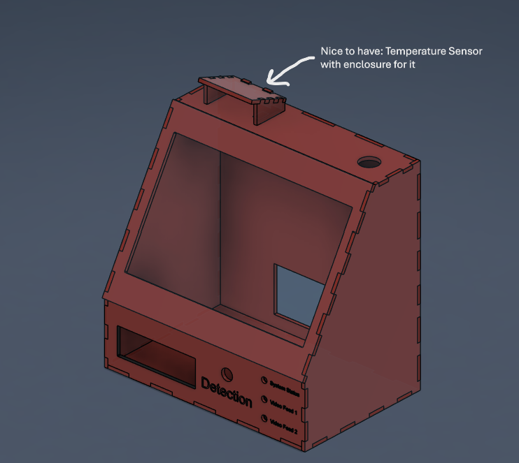
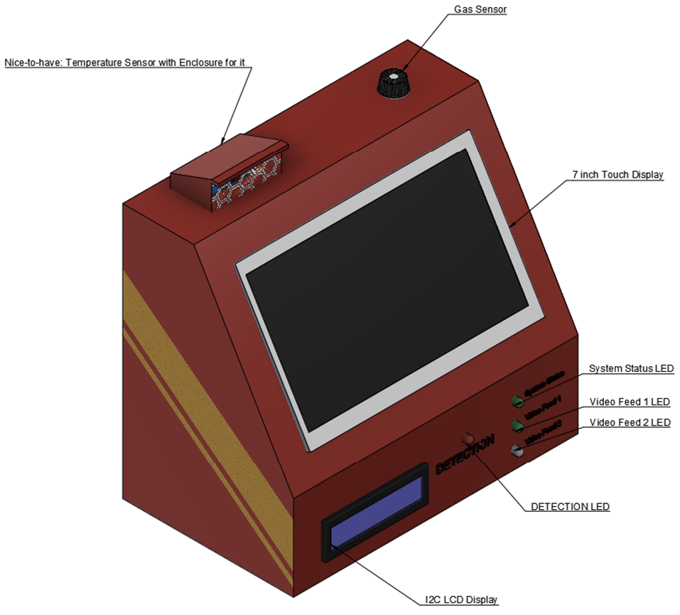
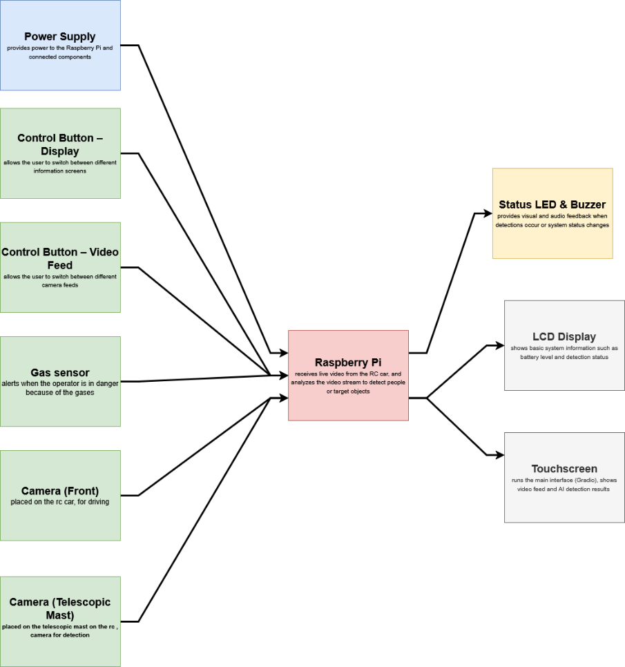

# Project Definition (PD) — P1 CTAI

Fill in every table below, just like you did with the real PD.

---

## 1. Project identity

| Field                | Your answer                                      |
| -------------------- | ------------------------------------------------ |
| **Working title**    | RC CAR search-and-rescue system                  |
| **Student name**     | Vladyslav Drahan                                 |
| **Sparring partner** | Vsevolod Bereza                                  |
| **Project type**     | [✅] Vision [ ] Keypoint detection [ ] Non-visual |

---

## 2. Concept & impact

| Topic            | Your answer                                              |
| ---------------- | -------------------------------------------------------- |
| **Objective**    | Develop a working AI prototype for helping rescuers locate missing people during search-and-rescue |
| **Target group** | Emergency & Rescue services, Police Units & Military     |
| **Core problem** | Difficulty in quickly and accurately locating people in need of assistance in complex, low-visibility, or hard-to-reach environments              |
| **Key question** | How can an AI-based vision system support the detection of people in need of rescue in complex environments?                |
| **Impact**       | This helps rescuers find missing or injured people faster. The system analyzes live video and alerts the user with visual and sound signals when a person is detected. This reduces search time and improves the chances of saving lives.              |

---

## 3. AI & data pipeline

### 3A. Method & data

> **Note:** Standard **image classification only** (single label per image, no boxes/keypoints) is **not allowed**.

| Requirement                    | Your answer                                                                                       |
| ------------------------------ | ------------------------------------------------------------------------------------------------- |
| **Dataset — how & where**      | I will manually collect my dataset by taking photos indoors, in the park and around the campus using my phone/camera, which will be mounted on selfie stick/telescopic pole placed on the RC car. |
| **Classes (min. 4, target 6)** | 1. Lying person 2. Standing person 3. Sitting person 4. Crawling person 5. Partially Hidden person            |
| **Volume**                     | [ ] ≥ 100 annotations **per class** planned (yes/no + rough count per class)                      |

| Class name | Planned # samples / annotations |
| ---------- | ------------------------------- |
|1. Lying person| 100                                |
|2. Standing person | 100                                 |
|3. Sitting person  | 100                                |
|4. Crawling person | 100                                |
|5. Partially Hidden person | 100                                |
|            |                                 |

### 3B. Training & export

| Project type           | Your choice & model                                                          |
| ---------------------- | ---------------------------------------------------------------------------- |
| **Vision**             | Recent **YOLO** model trained in Python — model name/version: YOLO11s                |
| **Keypoint detection** | Pretrained **MediaPipe** (or similar) → custom classifier on top — describe: |
| **Non-visual**         | Model / approach:                                                            |

| Topic                    | Your answer                                                              |
| ------------------------ | ------------------------------------------------------------------------ |
| **Model information**    | YOLO11s — Input size: 640×640; Weights stored in `RPi/ai/best.pt`; Export format: PyTorch `.pt` |
| **Training environment** | [✅] Laptop [ ] RPi [ ] Cloud — details: Trained on laptop using Python/YOLOv11, then transferred to RPi |
| **Export to RPi**        | The trained model (e.g.`best.pt`) is exported from the laptop and uploaded to GitHub. During deployment, it is pulled into the needed directory and loaded.                   |

---

## 4. Hardware & Makerlab plan

### 4A. Mandatory hardware

| Requirement                       | Your implementation                                                  |
| --------------------------------- | -------------------------------------------------------------------- |
| **Headless-first**                | [ ] Physical button start/stop [✅] Gradio only [ ] Both — describe: |
| **Visual feedback (mandatory)**   | LCD / OLED type & what it shows: It shows brief statistics and system status |
| **Hardware feedback (mandatory)** | LEDs / buzzer / servo — what signals what: LEDs - will be used for demonstrating the system and detection status. Buzzer - -	will provide audio feedback when a person is detected                          |
| **Extra sensor or actuator**      | Gas sensor — Used for detecting if the operator is in dangerous environment, filled with gases;( _Nice-to-have_: Temperature sensor - Used for detecting if the operator is in the safe environment with normal temperature for a human being)  |

### 4B. Build quality (Makerlab)

| Criterion            | Your plan                                                      |
| -------------------- | -------------------------------------------------------------- |
| **Housing**          | Laser-cut (photo attached below)                                                      |
| **Cable management** | Cables will be neatly managed by using cable straps, ensring proper cable management and sequrity            |
| **Safety**           | Everything will be hiden in the nice enclosure, with only holes for ventilation                      |
| **Aesthetics**       | Material: ABS enclosure (3 mm); Colors: Red and Yellow; Labels: All of the labels will locate under the LEDs indicating its role. The labels will be engraved useing laser-cutter         |

---

## 5. Software & visualisation

### 5A. Gradio interface (mandatory pages)
.
| Page                   | Content you will show                        |
| ---------------------- | -------------------------------------------- |
| **About & onboarding** | This page is for first-time users so they can understand how to use the system correctly.
It will contain simple user instructions          |
| **Data**               | This page will display live system data and AI results.      |
| **Operating**          | This page shows the main system functionality during operation. |
| **Debugging**          | This page is used for testing and development.      |

| **Link to kickoff codebase** | [[https://github.com/howest-mct/2025-2026-ProjectOne-CTAI-YourName]](https://github.com/howest-mct/2025-2026-ProjectOne-CTAI-YourName]) |
| ---------------------------- | --------------------------------------------------------------------------------------------------------------------------------------- |
| **Extra pages (optional)**   |                                                                                                                                         |

### 5B. Backend & data

| Component    | Your answer                                                       |
| ------------ | ----------------------------------------------------------------- |
| **Database** | Postgres. The database will store data generated by the system, such as: detection results from the AI model; number of detected people ; timestamps of detection events ; system status information. The database will also store system event logs:when the AI detection is turned on or off; when the video feed is connected ; when a person is detected; when the system starts or stops processing; when an error or warning occurs                                          |
| **Docker**   | [✅] Yes — compose file location: [ ] No — justification:          |
| **API**      | Gradio will be used to display system data and detection results. FastAPI will be used for communication between components.|

---

## 6. System architecture (block diagram)

Paste your diagram below (image or Mermaid). Use these **colours**:

| Colour | Meaning                                  |
| ------ | ---------------------------------------- |
| Red    | Microcontroller (Raspberry Pi) or laptop |
| Green  | Sensors                                  |
| Yellow | Actuators                                |
| Grey   | Display                                  |
| Blue   | Power supply                             |

**Also label:** where AI runs (Pi vs laptop) and what each model does.

