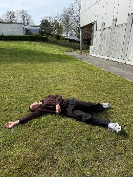
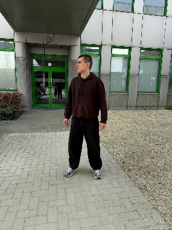
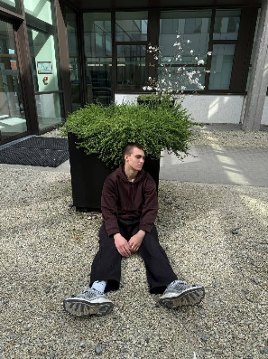
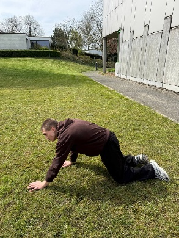
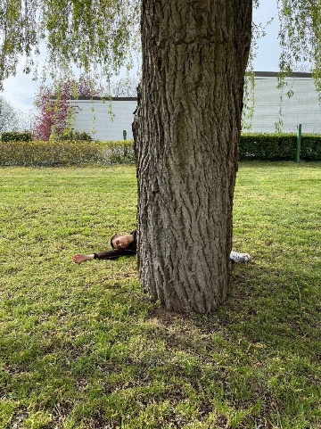
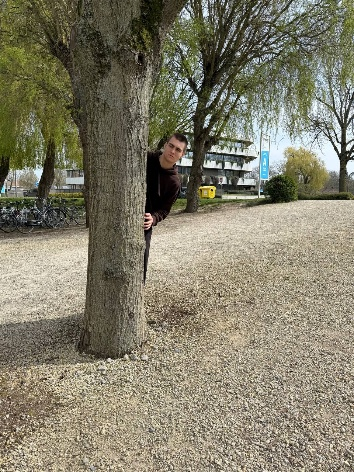
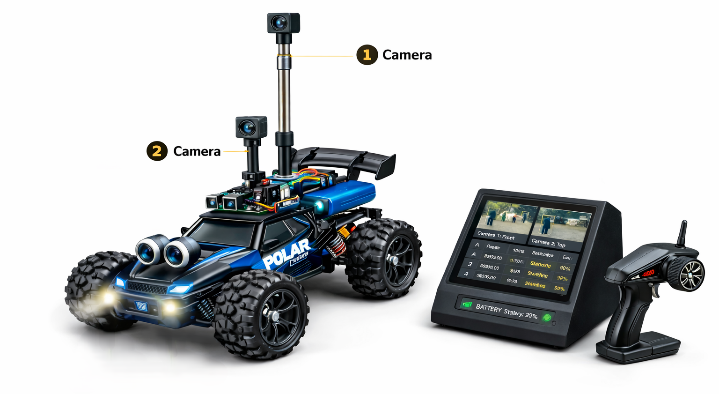
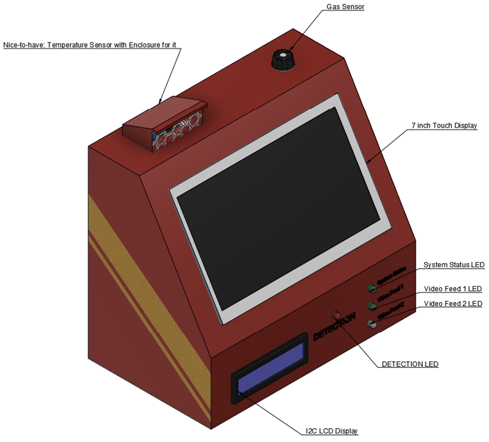
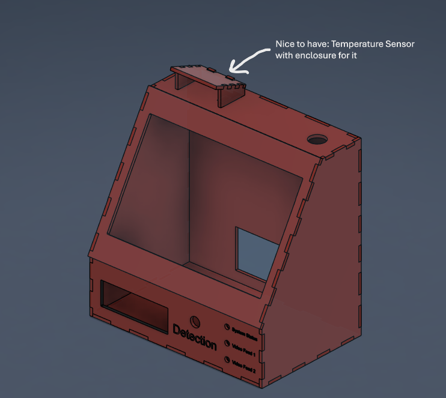
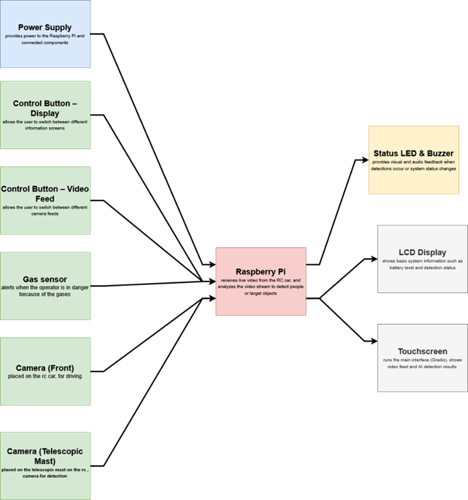

# RC Car Search-and-Rescue System

Project definition: [PD.md](../PD.md)

---

Course reference material: [examples/Docs/README.md](../examples/Docs/README.md)

The runnable implementation lives in backend/api, backend/station, and
frontend. The examples directory contains the original course starter and
hardware smoke-test material; it is not part of the deployed application.

## Project status

This repository contains a working end-to-end prototype: PostgreSQL persistence,
a FastAPI data API, a separate FastAPI detection station, a Gradio operator UI,
mock hardware/cameras for laptop demonstrations, and real-mode adapters for the
Raspberry Pi deployment. It is a prototype for supervised demonstrations, not a
certified emergency-response product.

## 1. Project identity

**Working Title:** RC CAR search-and-rescue system - version 2  
**Student Name:** Vladyslav Drahan  
**Sparring Partner:** Vsevolod Bereza                
**Project Type:** Vision


## 2. Concept & Impact

**Objective:** Develop a working AI prototype for helping rescuers locate missing people during search-and-rescue.

**Target Group:** Emergency & Rescue services, Police Units & Military.

**Core Problem:** Difficulty in quickly and accurately locating people in need of assistance in complex, low-visibility, or hard-to-reach environments.

**Key Question:** How can an AI-based vision system support the detection of people in need of rescue in complex environments?

**Impact:** This helps rescuers find missing or injured people faster. The system analyzes live video and alerts the user with visual and sound signals when a person is detected. This reduces search time and improves the chances of saving lives.


## 3. AI & Data Pipeline

### Method & Data

I will manually collect my dataset by taking photos indoors, in the park and around the campus using my phone/camera, which will be mounted on selfie stick/telescopic pole placed on the RC car.

#### 5 Main Classes:

- Lying person



- Standing person



- Sitting person




- Crawling person



- Partially Hidden person





These classes describe the most realistic positions of a person in danger.

### Training & Export

- Vision model: YOLOv26


## 4. Hardware & Makerlab plan

### Hardware

**Headless-First:** Person can start/stop via Gradio.

### System Overview

The system consists of an RC car with cameras and a base station with a Raspberry Pi. The user drives the RC car while the cameras send live video to the base station. The video is transmitted wirelessly from the RC car to the base station using cameras supporting RTSP. The Raspberry Pi processes the video in real time using the AI model to detect people. The gas sensor alerts the user if dangerous environmental conditions are detected.

When a person is detected:

- the result is shown on the screen
- a buzzer sound is played
- LEDs indicate detection
- the detection is saved in the database

The user can monitor everything through the touchscreen and LCD display. Two buttons are used to control the system:

**Gradio Display Control Button**

Changes the information shown on the LCD display. For example:

- System Status Screen:
  - STATUS: ACTIVE
  - VIDEO: CONNECTED

- Last Detection Screen:
  - LAST DETECTION
  - CLASS: lying_person, TIME: 08:30:59

- Detection Screen:
  - PERSON DETECTION
  - CLASS: lying_person, TIME: 12:30:59

- Detection Statistics Screen:
  - TOTAL DETECTIONS: 5
  - Lying_person: 1

**Gradio Camera Switch Button**

Changes the video feed shown in Gradio.


### Visual Feedback

For a Visual Feedback I will use:

- Touch Display  
It will be used for representing the Gradio application, Database and Video feed from the cameras on the RC car.

- LCD display  
This ensures the operator can monitor the system.

Both displays are always visible in the base-station enclosure. They will show important systems information and detection history.


### Hardware Feedback

- Buzzer  
Will provide audio feedback when a person is detected.

- RGB LEDs  
will be used for demonstrating the system and detection status.


### Actuators/Sensors

- Gas Sensor  
Used for detecting if the operator is in dangerous environment, filled with gases.


### Build Quality

The AI system will be installed in a compact rectangular enclosure that serves as a rescue drone ground station. The housing will likely be wooden or 3D printed, depending on the materials available during building phase.

User interaction with system will happen through simple control panel on the front of the box. This panel will include touch display where user will be able to find important information such as system status and detecting results. For interactions 2 buttons will be available: first for changing pages with information on the LCD screen; second for changing the video feed. Also, on the front panel there will be several LEDs indicating the system and detection status. All other components and wiring will be arranged inside the enclosure to ensure proper cable management and security.

The RC car setup will consist of a power bank and two cameras. The first camera, mounted on the main roof, will function as an FPV camera for navigation. The second camera will be mounted on a telescopic pole attached to the car using a 3D-printed module and will serve as the detection camera. The power bank will be placed inside the car body and secured with reusable straps, providing power to both cameras.








## 5. Software & Visualisation


### Gradio Interface
### About & Onboarding

This page is for first-time users so they can understand how to use the system correctly.

It will contain simple user instructions, for example:

- how to connect the RC car video feed and start the ground station
- how to read the information displayed on the LCD and touchscreen
- how to use buttons to switch between pages and camera feeds
- how to recognise system status indicators


### Data

This page will display live system data and AI results.
It will show:

- number of people detected by the AI model
- a message when a person is detected
- current status of the AI model (active or paused)
- detection history
- gas detection alerts history


### Operating

This page shows the main system functionality during operation.
It will contain:

- live video feed from the RC car cameras
- switching between different camera feeds
- enabling or disabling the AI detection system
- displaying detection results in real time
- showing system status and updates


### Debugging


This page is used for testing and development.
It will include:

- checking if the LCD and touchscreen are working
- testing if the control buttons respond correctly
- verifying the video signal from the camera
- checking sensor data
- displaying basic system messages


### Backend & Data

### Database


The database will store data generated by the system, such as:

- detection results from the AI model
- number of detected people
- timestamps of detection events
- system status information

The database will also store system event logs:

- when the AI detection is turned on or off
- when the video feed is connected
- when a person is detected
- when the system starts or stops processing
- when an error or warning occurs


### API

Python, Gradio and optionally FastAPI will facilitate communication between the database, AI, and hardware. The backend will connect:

- the AI model for person detection
- the camera feed from the RC car
- the sensor
- the buttons and display
- the database
- the Gradio interface

Gradio will be used to display system data and detection results. FastAPI may be used for communication between components.


## 6. System Architecture (Block Diagram)

Color codes:

- Red: Microcontroller (Raspberry Pi) or Laptop
- Green: Sensors
- Yellow: Actuators
- Grey: Display
- Blue: Power supply




## 7. Possible Enhancements

### Night Vision or Thermal camera

Adding a thermal camera could improve the system's ability to detect people in situations where visibility is poor, such as at night or in dark areas. Thermal cameras detect body heat instead of normal light, which makes it easier to find people even when they are partially hidden by objects like plants or bushes. This could be especially useful for search-and-rescue situations during nighttime.

### Temperature & Humudity Sensor 

Adding the temperature sensor for detecting if operator is in dangerous environment, in extreme temperature area.  


## 8. Usage of AI

AI was used for choosing the appropriate hardware setup.


## 9. Running the system

Services: **db** (Postgres) · **api** (data API, FastAPI) · **station** (detection +
cameras + hardware, FastAPI) · **frontend** (Gradio). The station and frontend run
fully **mocked** by default, so the whole stack works on a laptop with no model,
camera or Raspberry Pi hardware.

```
Copy-Item .env.example .env  # PowerShell; adjust values and never commit secrets
```

### A. Docker Compose (laptop / everything mocked)

```bash
docker compose up --build
# frontend  -> http://localhost:7860
# data-api  -> http://localhost:8000/docs
# station   -> http://localhost:8001/docs   (mapped from container port 8000)
```

### B. Local development (no Docker)

```powershell
# Data API (terminal 1; DATABASE_URL must point to PostgreSQL)
py -3.12 -m venv .venv-api
.\.venv-api\Scripts\python.exe -m pip install -r backend\api\requirements.txt
.\.venv-api\Scripts\python.exe -m uvicorn backend.api.main:app --port 8000

# Station (terminal 2; mock mode)
py -3.12 -m venv .venv-station
.\.venv-station\Scripts\python.exe -m pip install -r backend\station\requirements.txt
Set-Location backend
$env:STATION_PORT = '8001'
$env:DETECTION_MODE = 'mock'
$env:HARDWARE_MODE = 'mock'
..\.venv-station\Scripts\python.exe -m station

# Frontend (terminal 3, started from the repository root)
py -3.12 -m venv .venv-frontend
.\.venv-frontend\Scripts\python.exe -m pip install -r frontend\requirements.txt
$env:STATION_URL = 'http://localhost:8001'
$env:API_URL = 'http://localhost:8000'
.\.venv-frontend\Scripts\python.exe -m frontend.app
```

> The three services have intentionally separate `requirements.txt` files and
> are isolated per-container; for local dev use a separate virtualenv per service
> (or just use Docker) — gradio and the FastAPI backends pin different `starlette`
> majors and should not share one venv.

### C. Raspberry Pi 5 (real detection + hardware)

```bash
# drop your trained YOLOv26 weights at ./backend/model/weights/best.pt
docker compose -f compose.yaml -f compose.pi.yaml up -d --build
```

The Pi override builds the station **full** image (torch + OpenCV + Pi libraries),
sets `DETECTION_MODE=real` / `HARDWARE_MODE=real`, and grants access to
`/dev/gpiochip0`, `/dev/i2c-1`, `/dev/video0` via `group_add` (gpio/i2c/video) —
**without** privileged mode. Adjust the device list to match your wiring (Pi 5's
40-pin header may appear as `gpiochip4`).

Backend details: [backend/station/README.md](backend/station/README.md).
